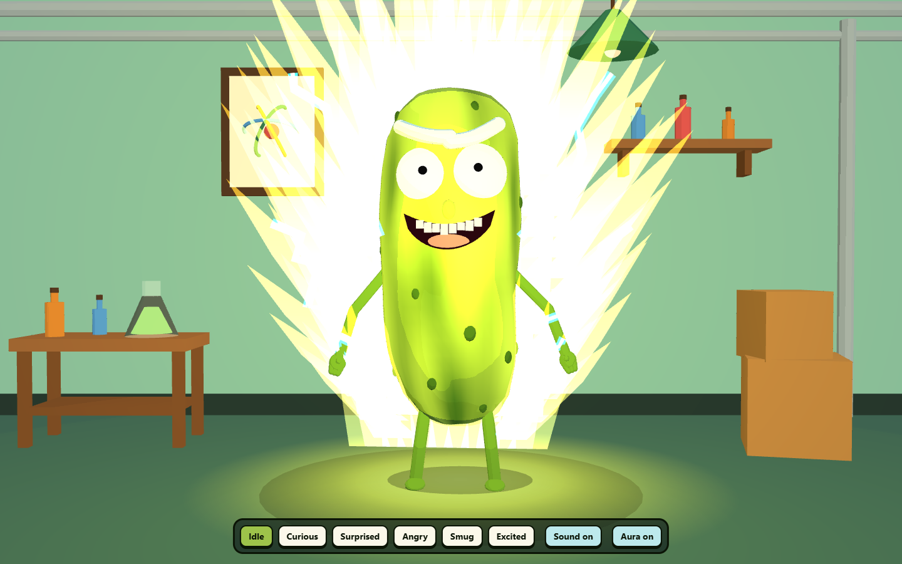

# 🥒 Pickle Prototype 0.1

An interactive, fully procedural 3D cartoon pickle living in a tiny laboratory.

It breathes, blinks and follows your cursor with its eyes. Flick the pointer and it flinches; do it
three times and it gets angry. Grab it, throw it, watch it bounce back. And if you want the full
cartoon power fantasy, the Super Saiyan aura is one button away.

[](https://nextjs.org)
[](https://react.dev)
[](https://threejs.org)
[](src)



Built with **Next.js**, **React Three Fiber** and **Three.js**. Every mesh, material, flame and
sound is generated in code: the app ships no imported 3D models, textures, images or audio files.

## Features

### A character, not a model

- **Hand-authored body math.** A 13-point profile, deterministic surface lumps and a subtle bend
  define the pickle. The face and limbs are placed on that actual surface instead of floating.
- **Cel shading.** Three-band toon gradients, ink outlines and per-vertex greens, with no texture
  maps. The whole scene shares one palette and a set of reusable materials.
- **Rubber-hose limbs.** Two-segment arms and legs with body sockets, forward kinematics and poses
  driven by the current expression. Arms lift when excited, tuck when angry and flail on hops.
- **Six expressions** — Idle, Curious, Surprised, Angry, Smug and Excited — each with its own pose
  and easing speed. A startle snaps in; a smirk creeps in.

### Always alive

- Breathing, weight shifts, head tilts, fidgets, blinks with occasional doubles, and tiny eye
  saccades keep it from ever looking frozen.
- **Eye tracking.** Pupils aim at a ray-cast look target under your pointer, and the head leans
  after it. The camera also drifts subtly toward the cursor.
- **Cursor personality.** A quick flick startles it into a hop; three flicks make it angry. Moving
  close makes it curious; resting nearby earns a smug look; entering the window triggers two happy
  hops.
- **Grab and throw physics.** Pointer-offset grabbing, velocity tracking, cartoon gravity, bouncy
  landings, squash and stretch, motion lean and a weak spring home. Works with mouse and touch.

### Super Saiyan aura

- Layered golden flame spires behind and in front of the body, six regenerating cyan-and-white
  lightning arcs, a glowing ground pool and expanding shockwave rings.
- Color follows the current mood; brightness follows energy, hops, throws and flight. Toggle it with
  the **Aura** button, and your choice survives reloads.

### Sound with no sound files

- Every effect is an oscillator plus a gain envelope, synthesized with the Web Audio API: grab
  pop, UI click, throw whoosh, springy landing boing, startled double-gasp, happy chirp and angry
  grumble.
- Pitch, length and loudness scale with throw speed and landing impact. Audio is created lazily on
  the first gesture, and the **Sound** choice is remembered.

### A little world

- A complete cartoon laboratory built from primitives: workbench with a bubbling flask, bottle
  shelf, stacked crates, hanging lamp, atom poster, wall pipes and a fake soft shadow.
- Props are arranged outside the play area, so throwing the pickle around never clips the furniture.

### Accessible and responsive

- Real buttons with `aria-pressed`, visible focus rings and keyboard shortcuts `1`–`6`.
- A screen-reader description of the scene and a graceful message if WebGL cannot start.
- `prefers-reduced-motion` freezes idle motion, aura flicker and reaction hops, softens dragging,
  and removes bouncing while leaving sound intact.
- The camera dollies out on portrait screens and drag limits adapt, so the character never leaves
  the frame.

## Controls

| Action | Control |
| --- | --- |
| Look around | Move the pointer |
| Pick up / carry | Press and drag the pickle |
| Throw | Release while moving |
| Change expression | Click a button, or press `1`–`6` |
| Toggle sound | **Sound on / off** |
| Toggle aura | **Aura on / off** |
| Startle it | Flick the pointer quickly across the scene |
| Make it angry | Flick three times in a row |
| Make it curious / smug | Move close / hold still nearby |

## Getting started

Requires **Node.js 20.9 or newer** (built and tested with Node 24).

```bash
git clone https://github.com/ZenasEC/pickle-rick.git
cd pickle-rick
npm install
npm run dev
```

Open [http://localhost:3000](http://localhost:3000).

### Scripts

| Command | What it does |
| --- | --- |
| `npm run dev` | Start the Next.js dev server |
| `npm run build` | Create a production build |
| `npm start` | Serve the production build |
| `npm test` | Run the Vitest suite (75 tests) |

The app is a standard Next.js App Router project and deploys as-is to Vercel or any Node host.

## How it works

```
src/
├── app/                        Next.js shell, metadata and global styles
├── scene/
│   ├── MainScene.tsx           Canvas, camera rig, UI and persisted settings
│   ├── Laboratory.tsx          Procedural workbench, flask, shelf, lamp, poster, pipes
│   └── viewport.ts             Portrait camera fit and responsive drag bounds
├── components/
│   ├── ExpressionPicker.tsx    Accessible expression / sound / aura buttons
│   └── PickleRick/
│       ├── PickleRick.tsx      Character root and group hierarchy
│       ├── bodyShape.ts        Profile, lumps, bend and surface placement math
│       ├── PickleBody.tsx      Body mesh built from the profile
│       ├── PickleFace.tsx      Eyes, brows, teeth and expressive mouth
│       ├── ExpressionController.ts  Expression table, speeds and pose easing
│       ├── Aura.tsx            Flames, lightning, ground glow and shock rings
│       ├── FlameShape.ts       Seeded flame and bolt geometry
│       ├── limbs/              Sockets, limb meshes and joint configuration
│       └── animation/          Layered per-frame animation state
├── audio/sfx.ts                Web Audio synthesis and mute persistence
└── hooks/                      Pointer state, eye tracking and drag handlers
```

### Layered animation

One mutable `CharacterState` lives in a React ref, so the per-frame loop never triggers a render.
Each frame runs a fixed stack of layers:

1. **Idle** — breathing, bobbing, swaying and fidgets.
2. **Look** — eye and head direction toward the pointer.
3. **Expression** — eases the live pose toward the selected expression table entry.
4. **Reactions** — short overrides for startles, curiosity, smugness and arrivals, plus a hop
   spring.
5. **Drag physics** — carry, throw, gravity, bounce, squash and homing.
6. **Aura** — glow, mood color and burst rings. Blink, eye micro-movement and limb layers sit
   alongside these.

Components only read the state. Because every layer is a pure function over plain numbers, the
whole system runs under Vitest in Node with no browser or WebGL.

### Procedural by design

- The body is a non-uniform surface: profile interpolation plus sinusoidal lumps, then a sideways
  bend below the face. Face parts and limb sockets ask the same functions where the surface is,
  so nothing floats or sinks.
- Flames are indexed triangle meshes rewritten each frame from seeded pseudo-random silhouettes.
  Lightning uses the same seeded jitter so it looks flickery without flickering into nonsense.
- The laboratory and UI are built from boxes, cylinders, cones and shared toon materials.
- Frame loops reuse vectors and raycaster instances instead of allocating per frame. Pixel ratio is
  capped, and the ground shadow is a translucent circle rather than a shadow map.

### Tests

```bash
npm test
```

**8 files, 75 tests**, covering body-surface math, limb placement and collision, expressions,
cursor reactions, drag physics, blinking, idle motion, aura behavior, flame/bolt geometry, sound
parameter mapping and responsive viewport math.

## License

No license has been specified for this project.
